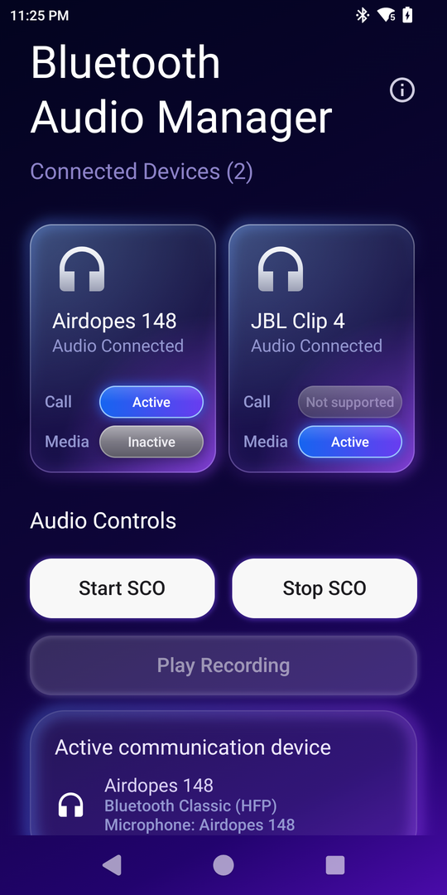
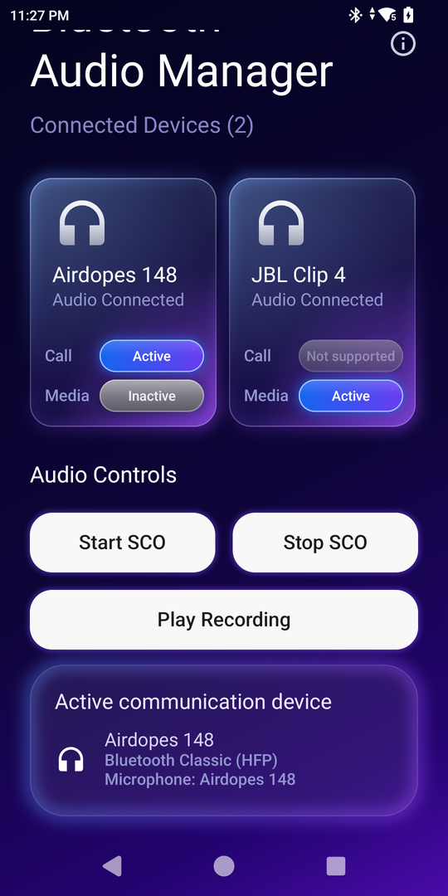
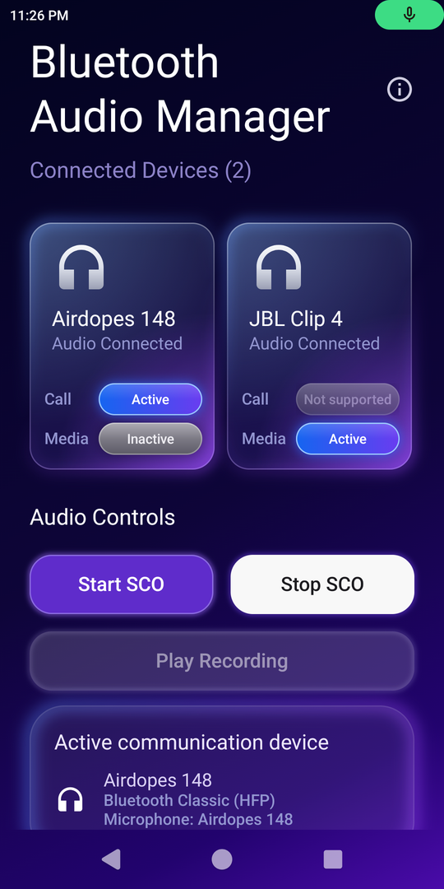
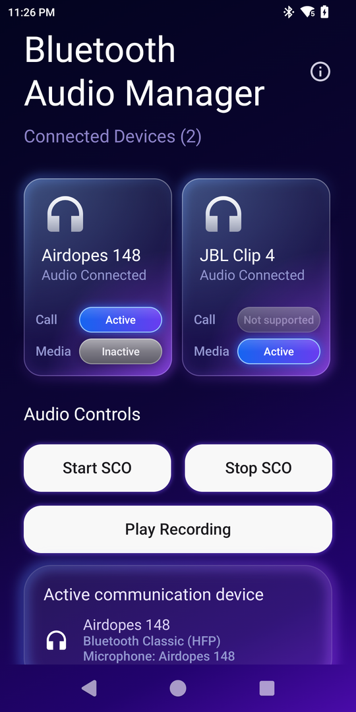
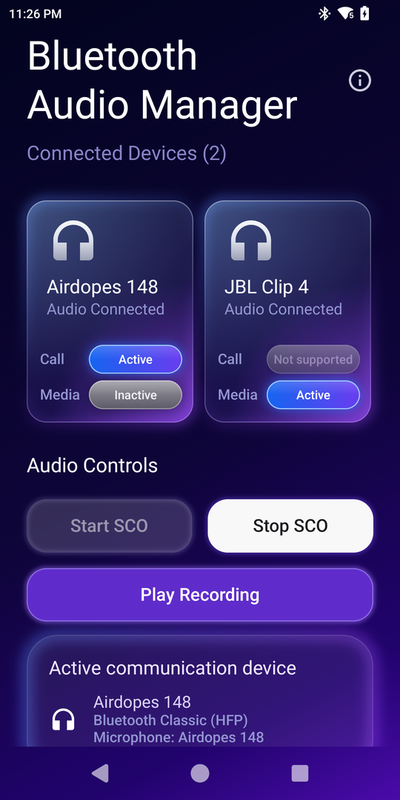

# Bluetooth Test App

A single-screen Android test app (**Bluetooth Audio Manager**) that shows which audio devices are connected and where Android sends audio:

- **Connected devices**: every connected Bluetooth audio device (and wired 3.5 mm / USB device), each on its own card.
- **Call and Media status**: for each device, whether Android sends call (two-way) audio and media audio to it.
- **Active communication device**: the device that two-way audio (calls, SCO) uses, and the microphone it records from.
- **Audio controls**: open an SCO link and record the headset microphone, stop SCO, and play the recording back on the active media device.

It is a generic test tool for checking audio routing on any Android device (phone, tablet or other handheld) running Android 11 (API 30) or later. It does not depend on any particular device maker or headset brand.

<p align="center">
  
</p>

---

## Contents

- [The screen](#the-screen)
- [Device cards: Call and Media status](#device-cards-call-and-media-status)
- [Active communication device](#active-communication-device)
- [Audio controls](#audio-controls)
- [Walkthrough with screenshots](#walkthrough-with-screenshots)
- [How the active devices are chosen](#how-the-active-devices-are-chosen)
- [Android 11 and Android 12+](#android-11-and-android-12)
- [Permissions](#permissions)
- [Logcat tags](#logcat-tags)
- [Project structure](#project-structure)
- [Build and run](#build-and-run)
- [Updating the screenshots](#updating-the-screenshots)

---

## The screen

From top to bottom:

| Section | What it shows |
| --- | --- |
| **Bluetooth Audio Manager** | The title. |
| **Connected Devices (n)** | The number of connected Bluetooth and wired audio devices, followed by one card per device in a horizontal list. When nothing is connected, a single **Host Device** card (the Android device itself, shown with its model name) is shown instead. |
| **Audio Controls** | The **Start SCO**, **Stop SCO** and **Play Recording** buttons. |
| **Active communication device** | The device Android uses for two-way audio, how it is linked (built-in, wired, Bluetooth Classic (HFP) or Bluetooth LE Audio), and which microphone is used. |

The screen updates by itself whenever a device connects or disconnects, or whenever Android changes the active device. Nothing needs to be refreshed.

## Device cards: Call and Media status

Each card shows the device icon, its name, **Audio Connected**, and two rows:

- **Call**: two-way call audio with the device's microphone (HFP on Bluetooth Classic, or LE Audio).
- **Media**: one-way, high-quality media audio (A2DP on Bluetooth Classic, or LE Audio).

Each row has one of three statuses:

| Status | Look | Meaning |
| --- | --- | --- |
| **Active** | Blue-violet, glowing | Android sends this kind of audio to this device right now. |
| **Inactive** | Grey | The device supports this kind of audio, but Android sends it to another device. |
| **Not supported** | Dimmed grey | The device cannot handle this kind of audio at all. |

Calls and media can be active on **different** devices. For example, in the screenshot above:

- **Airdopes 148** (earbuds with a microphone) is **Call: Active** and **Media: Inactive**.
- **JBL Clip 4** (a speaker with no hands-free profile) is **Call: Not supported** and **Media: Active**.

A pure speaker such as the JBL Clip 4 does not offer the hands-free (call) profile, so its **Call** row is always **Not supported**. A call-only headset shows the opposite: **Media: Not supported**.

## Active communication device

The card at the bottom names the device that two-way audio (calls and **Start SCO**) goes to:

- **Name** of the device, e.g. *Airdopes 148*.
- **Link**: *Bluetooth Classic (HFP)*, *Bluetooth LE Audio*, *Wired (3.5 mm jack)*, *Wired (USB)*, or *Built-in earpiece and speaker* for the host.
- **Microphone**: the device's own microphone, or *built-in* when the device has none (for example wired headphones without a mic).

This card is about calls only. Media can play somewhere else, which the device cards show.

<p align="center">
  
</p>

## Audio controls

| Button | What it does | When it is enabled |
| --- | --- | --- |
| **Start SCO** | Switches the audio mode to *in communication*, asks Android to open SCO to the active call headset, and once the link is up records **10 seconds** from the headset microphone. Then it closes SCO and keeps the recording. If SCO does not come up within **5 seconds**, the session is ended. While the session runs the button turns **purple** and cannot be tapped. | A Bluetooth headset is the active communication device, no SCO session is running, and no recording is playing. |
| **Stop SCO** | Ends a running session early and keeps what was recorded so far. With no session running it still calls Android's stop API, so you can see in Logcat how the platform reacts. | Whenever a Bluetooth headset is the active communication device (even with no session running, for experiments). |
| **Play Recording** | Plays the latest recording as media audio. Android sends it to the **active media device** (the device whose **Media** row is **Active**), or to the host's speaker when no device is active for media. While playing, the button turns **purple** and cannot be tapped. | A recording exists and is not playing already. |

Notes:

- Only the latest recording is kept (16 kHz mono AAC, `.m4a`, in the app's cache folder). **Start SCO** deletes the previous one.
- The recording exists only while the app is open: it is deleted when the app starts and when the screen is closed. So **Play Recording** is always disabled when the app opens.
- With no Bluetooth headset active for calls (only the host, a wired device or a speaker), **Start SCO** and **Stop SCO** are disabled.

## Walkthrough with screenshots

These were captured on an Android 14 device with two Bluetooth devices connected:

1. **Airdopes 148** was connected first, so Android made it active for calls (and its microphone the communication microphone).
2. **JBL Clip 4** was connected second, so Android moved **media** to it. Calls stay on the Airdopes, because the JBL has no call profile.

<table>
  <tr>
    <th>1. Two devices connected</th>
    <th>2. Start SCO: recording</th>
  </tr>
  <tr>
    <td></td>
    <td></td>
  </tr>
  <tr>
    <td>Airdopes 148 is <b>Call: Active</b>, JBL Clip 4 is <b>Media: Active</b>. <b>Start SCO</b> and <b>Stop SCO</b> are enabled because a Bluetooth headset is the communication device. <b>Play Recording</b> is disabled because there is no recording yet.</td>
    <td>After tapping <b>Start SCO</b>, the button turns purple while SCO is open to the Airdopes and its microphone is recorded for 10 seconds. The green microphone indicator in the status bar shows the recording. <b>Stop SCO</b> stays enabled to end it early.</td>
  </tr>
  <tr>
    <th>3. Recording ready</th>
    <th>4. Play Recording: playing</th>
  </tr>
  <tr>
    <td></td>
    <td></td>
  </tr>
  <tr>
    <td>After 10 seconds SCO is closed and the recording is saved. All three buttons are enabled.</td>
    <td>After tapping <b>Play Recording</b>, the recording plays on the <b>active media device</b>, the JBL Clip 4. The button turns purple, and <b>Start SCO</b> is disabled until playback ends.</td>
  </tr>
</table>

## How the active devices are chosen

**Active communication device** (the bottom card and the **Call: Active** pill), in this order:

1. A Bluetooth headset (Classic HFP or LE Audio) that Android has made active for calls. Connected headsets do not count until Android makes one of them active. If Android does not say which headset is active (some devices don't, right after the app starts), the only headset connected for calls is used; with several, *Unknown Bluetooth headset* is shown rather than a guess.
2. Otherwise a wired device, because Android uses it instead of the earpiece and built-in microphone as soon as it is plugged in.
3. Otherwise the host (the phone itself).

**Active media device** (the **Media: Active** pill), in this order:

1. The wired device media plays through, if any.
2. The Bluetooth device Android plays media through (the one Android's Bluetooth settings marks as *Active*).
3. Otherwise the host.

The app combines two sources for this: AudioManager's audio devices (which list only the active Bluetooth devices) and the Bluetooth stack's broadcasts (active device changed, SCO audio connected, media playing). The second is needed because on some devices the SCO entry has a placeholder address, and the media entry can keep the previous device's address after switching.

## Android 11 and Android 12+

The parts that use different Android APIs have a `Legacy` (Android 11) and a `Modern` (Android 12+) implementation, picked at runtime:

| Part | Android 11 (API 30) | Android 12+ (API 31+) |
| --- | --- | --- |
| Open SCO | `AudioManager.startBluetoothSco()` | `AudioManager.setCommunicationDevice()` with the headset from `getAvailableCommunicationDevices()` |
| SCO link state | `ACTION_SCO_AUDIO_STATE_UPDATED` broadcast | `OnCommunicationDeviceChangedListener` |
| Close SCO | `AudioManager.stopBluetoothSco()` | `AudioManager.clearCommunicationDevice()` |
| Bluetooth permission | Install-time `BLUETOOTH` | Runtime `BLUETOOTH_CONNECT` |

On Android 13+ an LE Audio headset is supported as well: the same request opens LE Audio's two-way voice stream instead of SCO. The app still calls it "SCO".

## Permissions

| Permission | Why |
| --- | --- |
| `BLUETOOTH` (Android 11 only) | See connected Bluetooth devices. |
| `BLUETOOTH_CONNECT` (Android 12+, runtime) | See connected Bluetooth devices and their names. |
| `RECORD_AUDIO` (runtime) | Record the headset microphone. |
| `MODIFY_AUDIO_SETTINGS` | Change the audio mode and start or stop SCO. |

The runtime permissions are asked for when the app starts. Device detection starts as soon as the Bluetooth permission is granted. Wired devices need no permission.

## Logcat tags

Every step is logged, so you can compare what the screen shows with what Android really does:

| Tag | What it logs |
| --- | --- |
| `BluetoothAudioViewModel` | What the screen shows as active (communication device, microphone, media device), and button taps. |
| `ActiveDeviceResolver` | Active device changes from AudioManager and the Bluetooth stack, and which headset SCO audio actually connects to. |
| `ScoConnectionManager` | Each SCO step: mode change, request, connected, disconnected, stop. |
| `WiredDevicesDetector` | Wired devices plugged in or out. |

```bash
adb logcat -s BluetoothAudioViewModel ActiveDeviceResolver ScoConnectionManager WiredDevicesDetector
```

## Project structure

```
app/src/main/java/com/example/bluetoothtestapp/
├── MainActivity.kt                     Permissions, starts detection, hosts the screen
├── model/AudioDevice.kt                A device and its Call/Media support
├── viewmodel/
│   ├── BluetoothAudioUiState.kt        Screen state; active-device and button-enabled rules
│   └── BluetoothAudioViewModel.kt      Connects detection, SCO, recording and playback
├── bluetooth/
│   ├── connected/                      Connected Bluetooth devices (profile proxies + broadcasts)
│   ├── active/                         Active communication and media devices
│   └── sco/                            Open and close SCO (Legacy / Modern)
├── wired/                              3.5 mm and USB devices
├── recording/
│   ├── AudioRecorder.kt                Records the headset mic (VOICE_COMMUNICATION source)
│   └── RecordingPlayer.kt              Plays the recording as media
└── ui/
    ├── BluetoothAudioScreen.kt         The screen
    ├── components/                     Device card, active device card, buttons
    └── theme/                          Colours and typography
docs/screenshots/                       Screenshots used in this README
```

## Build and run

Open the project in Android Studio and run the `app` configuration on a device, or from the command line:

```bash
./gradlew installDebug
```

```bash
adb shell am start -n com.example.bluetoothtestapp/.MainActivity
```

Bluetooth audio can only be tested on a real device; the emulator has no Bluetooth.

## Updating the screenshots

The screenshots are in [`docs/screenshots`](docs/screenshots). To replace one, set up the state on the device and run:

```bash
adb exec-out screencap -p > docs/screenshots/01-two-devices-idle.png
```

The screenshots in this README were captured at 1080 x 2160 and scaled to 540 x 1080.
